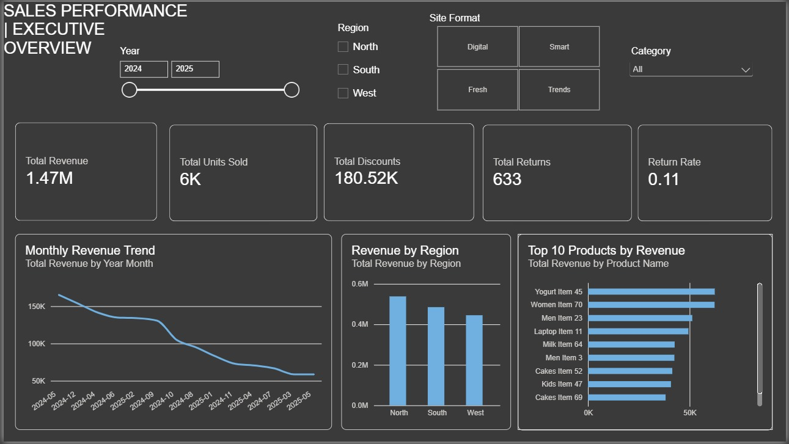
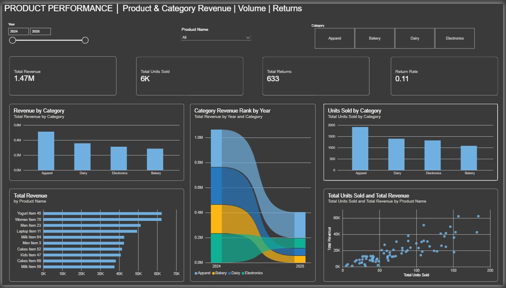
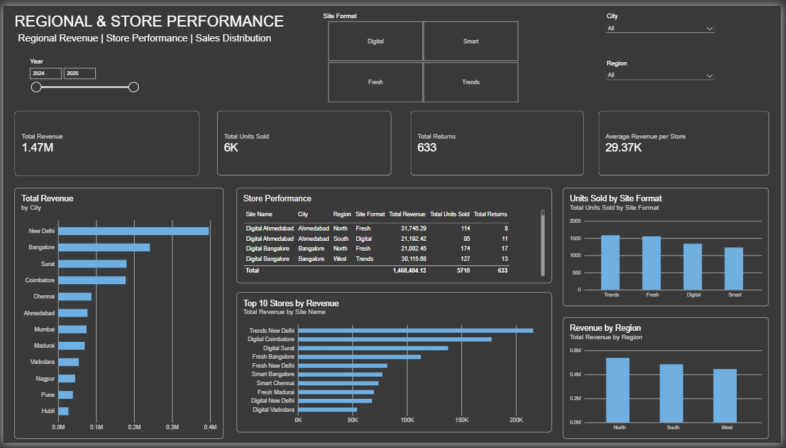
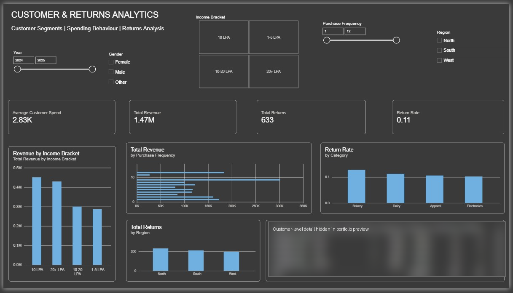

# Retail Sales Performance Dashboard

A retail reporting project built around a four-page Power BI dashboard for sales, products, regional and store performance, and customer and returns analysis. It brings those views together to help stakeholders examine reported results across time and business dimensions. The dashboard and source CSVs are available in the original project folder; this repository includes the verified page screenshots and evidence-based documentation. The source data has not been redistributed because its provenance and sharing rights are undocumented, and one file contains customer-linked demographic and spending attributes.

> **Report file status:** The source folder contains report-definition JSON and a `DataModel` binary, but no `.pbix` or complete `.pbip` entry point was found. The report itself is therefore not directly interactive from this repository.

## Table of contents

- [Executive summary](#executive-summary)
- [Business problem](#business-problem)
- [Business objectives](#business-objectives)
- [Project scope](#project-scope)
- [Tools and technologies](#tools-and-technologies)
- [Dataset](#dataset)
- [Data preparation and modeling](#data-preparation-and-modeling)
- [KPI definitions and reconciliation](#kpi-definitions-and-reconciliation)
- [Dashboard architecture and pages](#dashboard-architecture-and-pages)
- [Dashboard screenshots](#dashboard-screenshots)
- [Key observations and business implications](#key-observations-and-business-implications)
- [Business questions answered](#business-questions-answered)
- [Recommendations](#recommendations)
- [Limitations and assumptions](#limitations-and-assumptions)
- [How to view the report](#how-to-view-the-power-bi-report)
- [Repository structure](#repository-structure)
- [Skills demonstrated](#skills-demonstrated)
- [Future improvements](#future-improvements)
- [Conclusion](#project-conclusion)
- [Resume / LinkedIn summary](#resume--linkedin-summary)

## Executive summary

The dashboard organizes retail performance into four perspectives: executive sales, product/category performance, regional and store performance, and customer/returns analysis. Its report definition and screenshots show slicers for year, region, store format, category, city, product, gender, income bracket, and purchase frequency across the relevant pages.

Direct aggregation of the supplied `Sales_Data.csv` reproduces the headline totals: **1,468,404.13 revenue**, **5,710 units sold**, **633 returns**, and **180,515.84 discounts**. The currency is not specified in the source files. These figures reconcile with rounded dashboard cards; the units card is shown as `6K`, while an exact total of 5,710 is visible in a detail table. This is a descriptive reporting project. No increase in revenue, reduction in returns, cost savings, or profitability impact has been measured.

## Business problem

Retail stakeholders can struggle to consolidate sales and operational information across products, locations, stores, customers, discounts, and returns. Separate reports can make it difficult to compare performance consistently or move from a headline measure to the products, markets, or customer groups associated with it.

This dashboard addresses the reporting need by presenting these dimensions in a single multi-page analytical experience. It enables exploration of the supplied data under report filters; it does not prove why performance changed or that the dashboard caused a business outcome.

## Business objectives

- Monitor overall revenue, units sold, discounts, and returns.
- Compare monthly revenue and inspect product/category contribution.
- Compare revenue across regions, cities, and stores, and units by store format.
- Examine customer spend and purchase frequency alongside customer attributes.
- Review return metrics by category and region.
- Filter relevant pages by year, region, category, store format, city, product, gender, income bracket, and purchase frequency.

## Project scope

The supplied report definition contains four pages and visuals referencing sales, product, site, customer, and date fields. The source folder also contains eight CSV tables covering sales, products, sites, customer demographics, inventory, logistics, promotions, and monthly planning. The available dashboard uses a subset of those topics; the presence of an input file does not mean it is represented on a report page.

The project is a historical summary and exploration of the provided records. No scheduled refresh, live connection, deployment, or operational integration is evidenced in the files inspected.

## Tools and technologies

| Tool or artifact | Evidence |
|---|---|
| Power BI report definition | JSON page and visual definitions and a `DataModel` binary are present in the original folder. No `.pbix` or complete `.pbip` entry point was found. |
| CSV | Eight source tables are present; their schemas and row counts are summarized in [`data/README.md`](data/README.md). |
| Git and GitHub | Used to version and publish this documentation and screenshot repository. |

No SQL scripts or Python transformation code were found in the original project folder. DAX expressions and full Power Query steps could not be verified from the available artifacts.

## Dataset

The supplied CSVs are described in [`data/README.md`](data/README.md), with columns in the [data dictionary](documentation/data-dictionary.md). `Sales_Data.csv` has 219 rows covering **2 April 2024 through 14 May 2025**. It contains 50 customer IDs, 78 product IDs, and 49 site IDs. The supporting tables contain 50 customer records, 100 products, and 50 sites; all sales IDs match their corresponding supplied dimension file.

No source attribution, license, or statement that the data is synthetic was found. Example-like labels (such as `Yogurt Item 45` and `Supplier 1`) suggest sample data but do not establish provenance. No currency is stated. The raw CSVs are not published: the customer table links IDs to age, gender, income bracket, purchase frequency, and average spend, and its sharing status cannot be verified.

## Data preparation and modeling

The report definition references fields from `Sales_Data`, `Product_Information`, `Site_Details`, `Customer_Demographics`, and `Date_Table`. The CSV directory contains no standalone date table; the report references `Date_Table[Year]` and `Date_Table[Year Month]`. The full model relationships, date-table construction, Power Query steps, DAX definitions, and refresh process were not verifiable from the loose report artifacts.

For the documented reconciliation, the supplied CSVs were read and directly aggregated. Sales IDs were checked against the product, site, and customer files. All sales product, site, and customer IDs matched. This repository does not claim that the source data was cleaned or transformed in Power BI beyond what can be established from the report artifacts.

## KPI definitions and reconciliation

Amounts below retain the source's unspecified currency. Totals were independently calculated from the supplied CSVs. The report's underlying DAX is unavailable, so a matching total does not independently verify its exact measure expression or filter behavior.

| Dashboard metric | Source-data reconciliation | Interpretation / validation |
|---|---:|---|
| Total revenue | `SUM(Sales_Data[Revenue])` = **1,468,404.13** | Matches the `1.47M` display. Currency is unspecified. |
| Total units sold | `SUM(Sales_Data[Units Sold])` = **5,710** | Matches the exact detail-table total; the card rounds it to `6K`. |
| Total returns | `SUM(Sales_Data[Returns])` = **633** | Matches the displayed count. The source does not define whether a return is a unit, line, or event. |
| Total discounts | `SUM(Sales_Data[Discounts])` = **180,515.84** | Matches the `180.52K` display. Currency and gross/net treatment are unspecified. |
| Return rate | `633 / 5,710` = **0.1109** (11.09%) | This ratio matches the displayed `0.11`; it suggests returns divided by units sold, but the DAX denominator is not verifiable. The card omits a `%` sign. |
| Average revenue per store | Total revenue / 50 site records = **29,368.08** | Matches the `29.37K` display arithmetically. Only 49 sites have sales rows, so the report's store population/denominator needs confirmation. |
| Average customer spend | Mean of 50 `Average Spend` values = **2,825.57** | Matches the `2.83K` display arithmetically. The source's period and spend definition are unspecified. |

These reconciliations show how the displayed values relate to the supplied CSVs. They do not establish the DAX used by the report.

## Dashboard architecture and pages

The page names and visual fields below were checked against the report definition and screenshots.

1. **Sales Performance | Executive Overview** — KPI cards for revenue, units, discounts, returns, and return rate; monthly revenue line chart; revenue by region; top-products-by-revenue chart. Slicers include year, region, store format, and category.
2. **Product Performance** — revenue by category, units by category, category revenue rank by year, product revenue comparison, and units-versus-revenue scatterplot. Slicers include year, category, and product.
3. **Regional & Store Performance** — revenue by city and region, store performance table, top stores by revenue, units by store format, and average revenue per store. Slicers include year, store format, city, and region.
4. **Customer & Returns Analytics** — average customer spend, revenue by income bracket, revenue by purchase frequency, return rate by category, returns by region, and a customer-level table. Slicers include year, gender, income bracket, purchase frequency, and region. Customer-level table detail is obscured in the repository screenshot for privacy.

## Dashboard screenshots

### 1. Sales Performance | Executive Overview



*Headline sales KPIs, a monthly revenue line chart, regional comparison, and top products. The displayed month sequence is not chronological; see the validation notes below.*

### 2. Product Performance



*Product and category revenue/volume views, category ranking over time, and product-level comparison visuals.*

### 3. Regional & Store Performance



*City, region, store, and store-format comparisons, including a store performance table.*

### 4. Customer & Returns Analytics



*Customer spend and frequency alongside return views by category and region. The customer-level detail table has been obscured in this repository preview; the original screenshot in the source folder is unchanged.*

## Key observations and business implications

These observations are descriptive calculations from the supplied CSVs and visible report. They are not causal findings.

- **Revenue is concentrated across a few dimensions.** Apparel has the highest category revenue in this extract at **512,467.38** (about 34.9% of total). North is the highest-revenue region at **538,142.42**, followed by South at 485,130.01 and West at 445,131.70. These values provide comparison points for further investigation, not performance explanations.
- **The leading product is narrowly ahead.** `Yogurt Item 45` totals **62,357.04** in revenue, just above `Women Item 70` at 62,275.59. Product labels appear sample-like and the currency is unspecified.
- **The displayed monthly trend is sorted by revenue, not date.** The x-axis begins May 2024, then December 2024, April 2024, and other months out of sequence. This makes it unsuitable for interpreting change over time until the axis is sorted chronologically. The CSV's actual monthly totals range from 58,618.59 to 165,163.11 in this period.
- **Return-rate formatting needs clarification.** The source ratio of returns to units is 0.1109, or 11.09%, consistent with the card's `0.11` display if that is its denominator. The card does not show a percent sign, and the DAX formula is unavailable.
- **The average-store denominator needs review.** The 29.37K card matches total revenue divided by all 50 site rows, although only 49 sites appear in sales. Confirm whether sites without sales are intentionally included.
- **Income bracket labels are uneven.** The source and slicer use `1-5 LPA`, `10 LPA`, `10-20 LPA`, and `20+ LPA`. `10 LPA` is not a range and there is no `5-10 LPA` label; confirm intended segment boundaries before drawing conclusions from the income chart.
- **Metric units should be explicit.** Revenue and discounts have no stated currency. Returns, units, and discounts represent different measures and should not be compared as if they shared a unit.

## Business questions answered

Within the supplied data and report filters, the dashboard supports investigation of:

- What revenue, unit, discount, and return totals are reported?
- How does revenue vary by month, region, city, store, product, and category?
- Which products and categories lead on revenue or units?
- How do reported sales compare across store formats?
- How do revenue and spending metrics vary by income bracket or purchase frequency?
- How do return counts/rates vary by category and region?
- How do these views change under available year, region, product, store, and customer filters?

It does not establish business causes or outcomes without additional context and validation.

## Recommendations

The following are proposed actions for retail management, not outcomes measured by this project:

1. Correct the monthly chart's sort order and verify its date hierarchy before using it for trend decisions.
2. Define return rate explicitly, show it as a percentage if that is the intended measure, and document its numerator and denominator.
3. Confirm whether average revenue per store should include all 50 listed sites or only sites with sales in the selected period.
4. Review income-bracket boundaries with the business owner and align the slicer, source data, and chart labels.
5. Add currency, period, and units to titles or labels for revenue, discounts, returns, and units sold.
6. Compare product revenue with units, discounting, and returns before prioritizing assortment or promotion decisions.
7. Validate customer-level data provenance, privacy, and definitions before sharing or using segmented spend analysis.

## Limitations and assumptions

- The source folder has report JSON and a `DataModel` binary, but no `.pbix` file or complete `.pbip` entry point; the report is not interactive in this repository.
- The CSV provenance, license, and synthetic/operational status are unknown. Raw data is not included.
- DAX, full model relationships, Power Query steps, and refresh behavior could not be verified.
- Currency and several business definitions (returns, discounts, store size, purchase frequency, customer spend period) are not specified.
- The sales extract has 219 rows over roughly 13.5 months. Conclusions describe only those rows and should not be generalized to a wider business without validation.
- The customer page screenshot has its detail table obscured in the repository copy; the original file in the source folder is unchanged.
- No causal impact or financial benefit has been measured.

## How to view the Power BI report

The `.pbix` file was not present in the original folder, so it cannot be opened from this repository. The source folder contains loose report-definition JSON and a model binary, which were not copied as a substitute for a complete report package. To make the project interactive, add a verified `.pbix` or complete Power BI project after reviewing its model and confirming the data is safe to share. For a large `.pbix`, assess Git LFS or a GitHub Release rather than silently omitting it.

## Repository structure

```text
retail-sales-performance-dashboard/
├── README.md
├── screenshots/
│   ├── executive-overview.png
│   ├── product-performance.png
│   ├── regional-store-performance.png
│   └── customer-returns-analytics.png
├── data/
│   └── README.md
├── documentation/
│   └── data-dictionary.md
├── report/
│   └── README.md
└── .gitignore
```

## Skills demonstrated

- Retail business problem framing and stakeholder-focused reporting.
- Dashboard page and visual interpretation from report definitions.
- KPI reconciliation against source data, including denominator and formatting checks.
- Multi-dimensional sales, product, regional/store, customer, discount, and returns analysis.
- Data documentation, privacy-aware publication choices, and evidence-based recommendations.
- Git and GitHub repository organization.

DAX authoring, SQL analysis, Power Query transformations, and enterprise deployment are not claimed because the available evidence does not verify them.

## Future improvements

- Add the verified `.pbix` or complete report project after confirming data-sharing rights.
- Document the dataset's provenance and license; publish appropriately anonymized or synthetic data if authorized.
- Add verified DAX measures, relationship diagrams, Power Query steps, and date-table logic.
- Fix and recheck the month-axis sort, return-rate format/denominator, income brackets, and average-store population.
- Add an explicit currency, time period, and unit definitions to KPI labels.
- Add reproducible analysis scripts and tests if those are part of the actual project workflow.
- Revisit customer-level sharing after confirming whether the records are synthetic or properly de-identified.

## Project conclusion

The dashboard brings key retail performance dimensions into a coherent four-page reporting experience. The supplied sales rows support reconciliation of the headline totals and reveal presentation issues that should be addressed before trend or segment decisions are made. The README and screenshots make the current work reviewable while clearly identifying the missing interactive report package, undocumented data provenance, and unverified model logic.

## Resume / LinkedIn summary

**Retail Sales Performance Dashboard | Power BI, Retail Analytics** — Developed and documented a four-page retail performance dashboard spanning executive sales, product/category results, regional/store comparisons, and customer/returns views. Reconciled revenue, units, discounts, returns, average spend, and store averages to source CSVs; identified a nonchronological monthly axis and KPI-definition issues for follow-up. No causal business impact is claimed.
